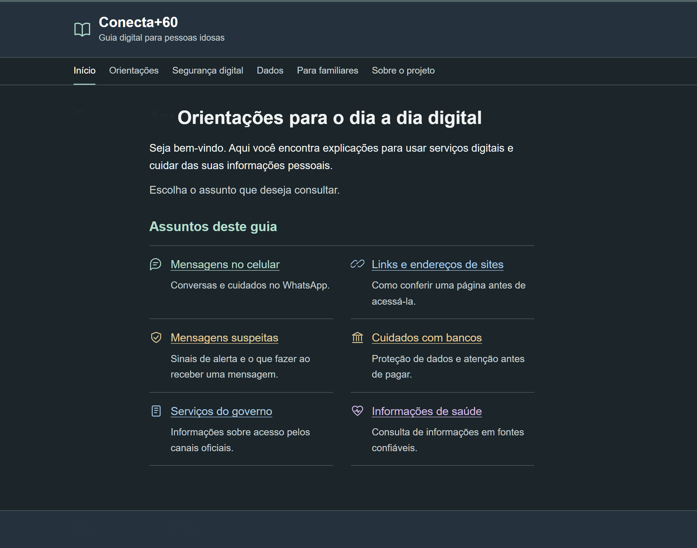
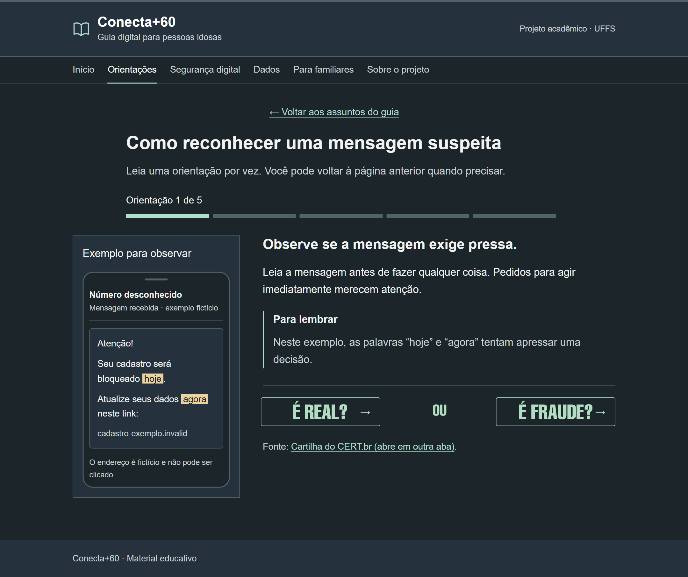

# Conecta+60

We are Computer Science students at UFFS, Chapecó campus, Brazil. We are developing this project together as part of our studies and our first steps in web development.

Our goal is to build an educational website for people aged 60 and over, with clear guidance on everyday digital tasks and online safety. We also hope it can support relatives and caregivers who help with these tasks.

We plan to cover messaging, suspicious links, personal data protection, government services, online banking, and reliable health information. Our proposal is aligned with **SDG 10 — Reduced Inequalities**, particularly **Target 10.2**, which promotes inclusion regardless of age.

## Our design proposal

We are using these mockups to discuss the layout and guide development. They are proposals, not a completed or evaluated website.

**Homepage**

**Practice activity about suspicious messages**

## References

Our project report draws on:

- [IBGE — PNAD Contínua](https://www.ibge.gov.br/estatisticas/sociais/populacao/17270-pnad-continua.html)
- [Scarpioni et al. (2016) — Educational environment for preventing internet scams](https://www.revistaespacios.com/a16v37n09/16370913.html)
- [CERT.br — Internet Safety Booklet](https://cartilha.cert.br/fasciculos/)
- [United Nations Brazil — SDG 10](https://brasil.un.org/pt-br/sdgs/10)
